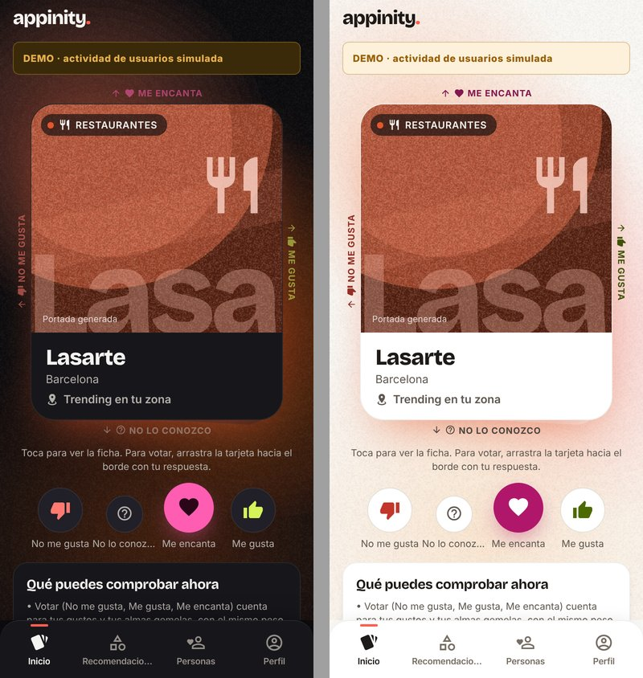
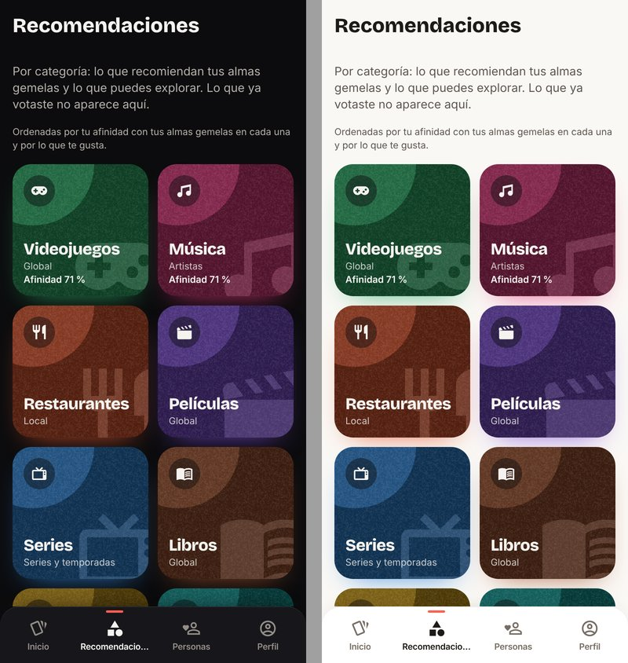
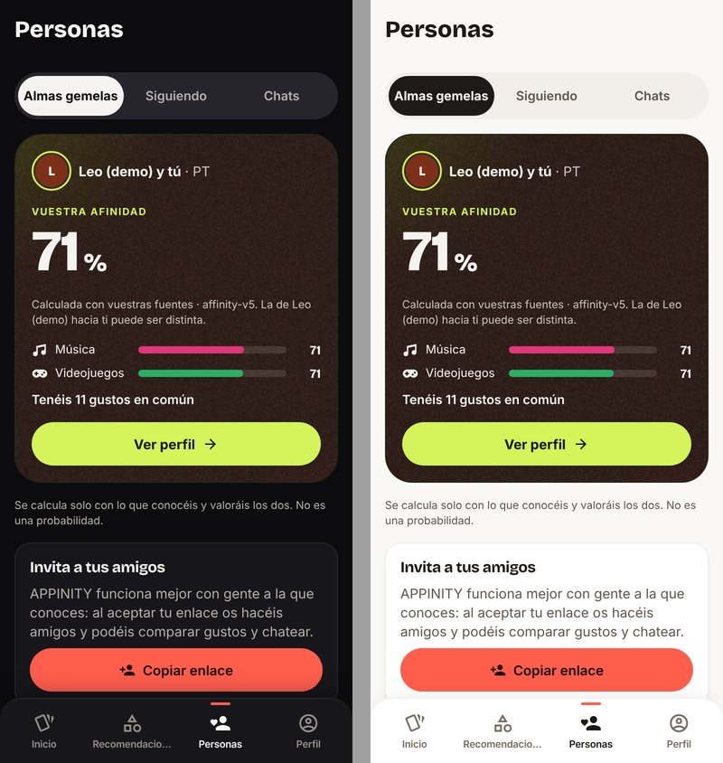
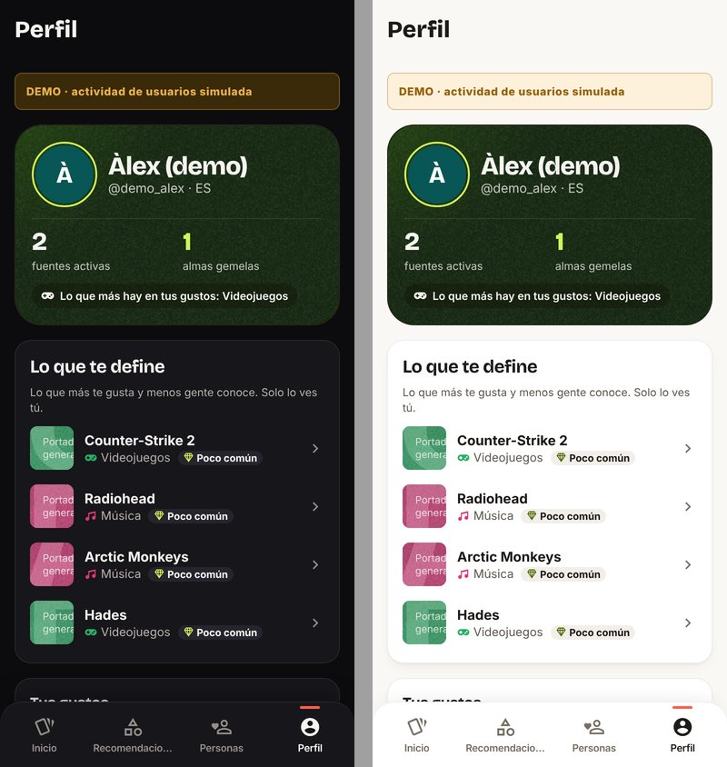
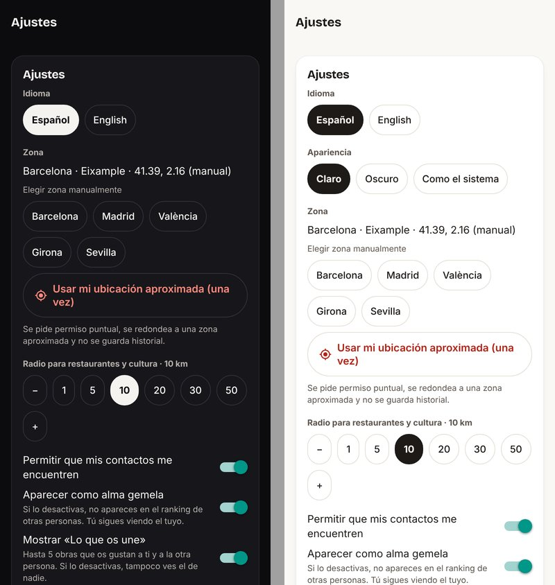
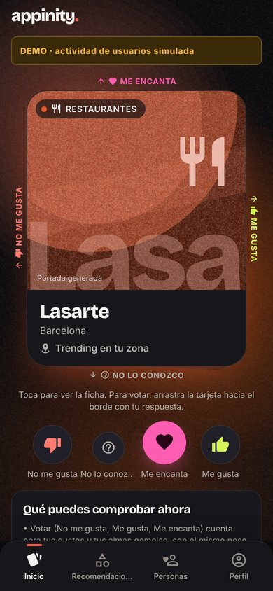

# Tema claro predeterminado (2026-11-26)

Petición del titular: las apps sociales de referencia (Tinder, Instagram, Hinge, Bumble…) usan fondo blanco o claro
como parte de su identidad; transmite cercanía, y el oscuro resulta más agresivo.

**Evaluación.** Acertado para APPINITY, con un matiz: las apps de *consumir contenido a pantalla completa* (TikTok,
Spotify, Netflix) son oscuras; las de *conocer personas* son claras. APPINITY es sobre todo lo segundo. Se pasa a claro
por defecto, con «Oscuro» y «Como el sistema» en Ajustes → Apariencia (preferencia del teléfono, no de la cuenta).

Dirección (Refresh Strategist de `/creative`, profundidad «pulido»: solo tokens, sin cambiar componentes):
«cálida, luminosa y cercana».

| Rasgo | Decisión | Motivo |
|---|---|---|
| Coral «Chispa» `#FF5E4D` solo en la acción principal | Se mantiene | Activo reconocible de la marca; con texto `#1A0806` da 6,4:1 en ambos temas |
| Verde de afinidad, rosa «Me encanta» | Se mantienen (variantes de texto ya calculadas para claro) | Significado fijo de la votación |
| Bricolage Grotesque en titulares | Se mantiene | Identidad tipográfica |
| Tarjeta «Cuatro direcciones» sobre la imagen con velo oscuro | Se mantiene | El texto sobre imagen necesita el velo en ambos temas |
| Carteles oscuros (almas gemelas, perfil, categorías) | Se mantienen | Funcionan como «imagen» dentro de la página clara; el verde lima solo se lee sobre oscuro |
| Fondo `#F6F4F1` | Evoluciona a `#FAF8F5` | Más luminoso, sin el blanco puro que deslumbra |
| Tarjetas planas con filete | Evolucionan: sombra suave teñida de cálido (`elevation`) | En claro la profundidad se lee con sombra; en oscuro, con el tono de la superficie |
| Halo de Aura a intensidad plena | Evoluciona: 40 % en claro (`auraStrength`) | En claro se veía como una mancha rosada y restaba contraste a los rótulos |
| Rótulos de los bordes de votación al 55 % de opacidad | Se retiran | No llegaban a AA (2,4:1 en claro, 2,8:1 en oscuro): ahora color pleno y, en claro, un 30 % hacia el texto (`edgeInk`) |
| Sombra negra al 70 % bajo la barra de pestañas | Se retira en claro | Sombra de tema oscuro; en claro, `barShadow` cálida y suave |
| Pantalla de arranque oscura | Claro con el logotipo en tinta (`splash-icon-light.png`); oscura si el teléfono está en oscuro | Coherencia con el primer fotograma |

## Contraste (WCAG 2.1 AA)

Pares de la paleta, calculados con `python3` sobre los valores de `apps/mobile/src/theme.ts`: todos ≥ 4,5:1 en claro y
en oscuro (texto secundario sobre fondo claro: 4,77:1; «DEMO» sobre su fondo: 4,69:1). Rótulos de los bordes de
votación medidos sobre la captura real (Inicio, halo de Restaurantes, mediana del fondo): Me gusta 6,3:1, No me gusta
6,4:1, Me encanta 7,3:1, No lo conozco 5,9:1.

## Capturas (vista web 390×844, demo; no sustituye a la prueba en el teléfono)

Antes (oscuro) a la izquierda, después (claro) a la derecha.

El oscuro sigue disponible: 
